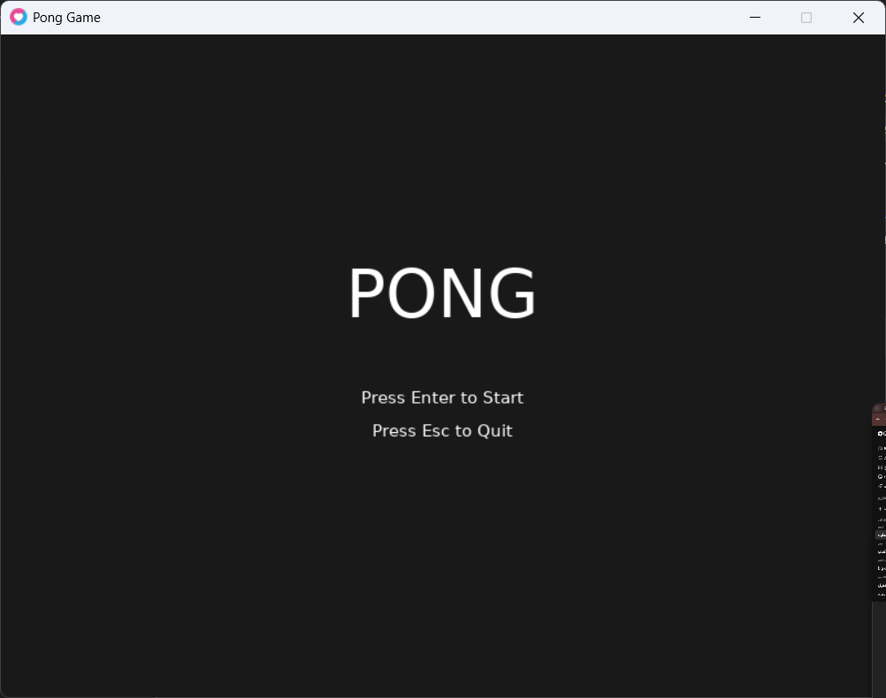
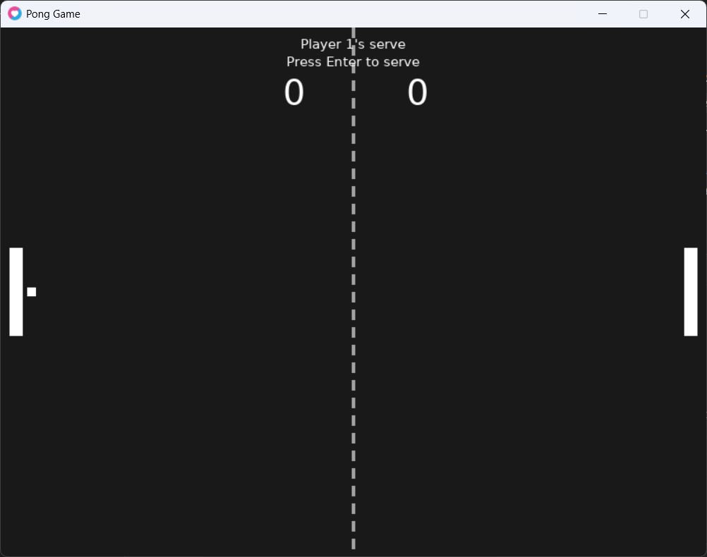
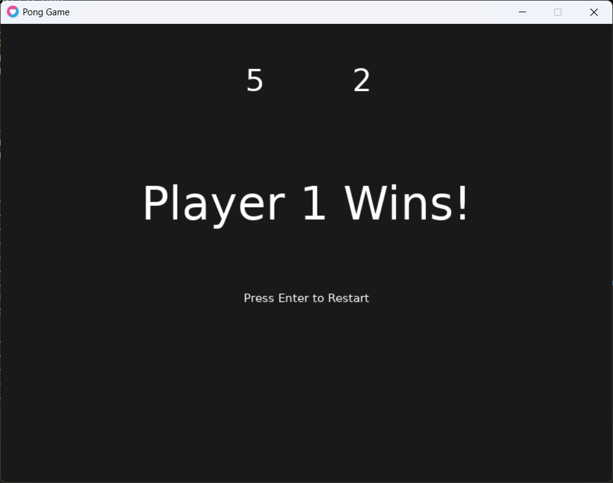

# Pong Game in Love2D

**Name:** Karim Tbaileh  
**Class/Section:** AI and Gaming

---

## Game Description

This is a classic Pong game built from scratch using Lua and the Love2D framework. The game features two-player local multiplayer where each player controls a paddle on their side of the screen. The objective is to score points by making the ball pass the opponent's paddle. The game includes realistic ball physics based on where the ball hits the paddle, a scoring system (first to 5 points wins), a main menu, and a progressive speed increase that makes the game more challenging as it progresses.

---

## How to Run

1. Make sure you have [LÖVE (Love2D)](https://love2d.org/) installed on your computer.
2. Clone or download this repository to your computer.
3. Open your terminal or command prompt.
4. Navigate to the project folder:
   ```bash
   cd pong-love2d
   ```
5. Run the game using the following command:
   ```bash
   love .
   ```

---

## Controls

| Action | Player 1 (Left) | Player 2 (Right) |
|--------|-----------------|------------------|
| Move Up | `W` | `Up Arrow` |
| Move Down | `S` | `Down Arrow` |
| Start / Serve / Restart | `Enter` | `Enter` |
| Quit Game | `Esc` | `Esc` |

---

## My Own Change

I added a **Progressive Speed Increase** feature that is not included in the tutorial videos. The ball's speed increases by **5% after every paddle hit**, making rallies more challenging and exciting as they continue. Additionally, the **base speed of the ball slightly increases every time a point is scored**, ensuring that later stages of the game are faster and more intense. To prevent the ball from clipping through the paddles at high speeds, a **maximum speed cap of 800** is also implemented. This feature adds a skill-based challenge where players must react faster as the game progresses.

---

## Screenshots

### Main Menu


### Gameplay


### Victory Screen


---

## Demo Video

Watch the short demo video showing the gameplay, scoring system, and the progressive speed increase feature:

[🎥 Watch Demo Video](demo/demo.mp4)

---

## Project Structure

```
pong-love2d/
├── main.lua              # Main game code
├── README.md             # This file
├── screenshots/          # Game screenshots
│   ├── menu.png
│   ├── gameplay.png
│   └── victory.png
└── demo/                 # Demo video
    └── demo.mp4
```

---

## Git Commit History

This project was built step by step with clear Git commits:

1. `Part 1: window and paddles` - Basic window, paddles, and movement
2. `Part 2: ball and collisions` - Ball movement, wall bounces, and AABB collision
3. `Add: Main Menu, Score, Realistic Bounce, and Progressive Speed Increase` - Final features

---

## Technologies Used

- **Language:** Lua
- **Framework:** [LÖVE (Love2D)](https://love2d.org/)
- **Version Control:** Git & GitHub

---

**Thank you for checking out my Pong game!** 🎮